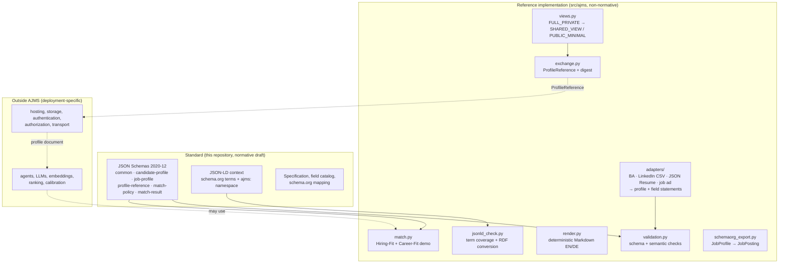
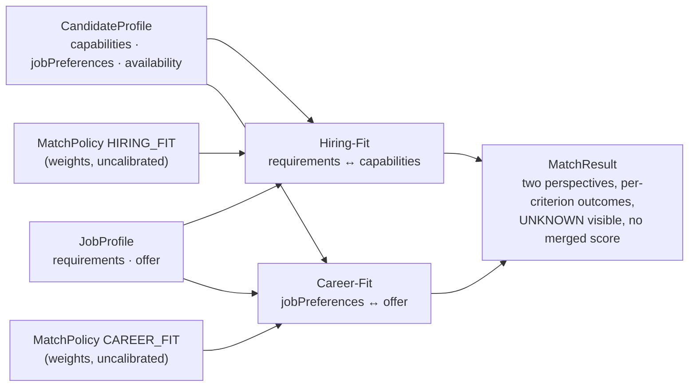

# Architecture overview

## Layers

## Data flow (bidirectional)

## Design decisions

| Decision | Rationale |
|---|---|
| Two document types with shared definitions instead of one "match document" | candidate and employer maintain their profiles independently; the same definitions make both directions comparable |
| JSON Schema for structure, JSON-LD context for meaning, checked separately | schema validity does not guarantee that a JSON-LD processor keeps every key |
| `hardCondition` / `wish` wrapper per criterion | wishes and hard conditions use the same shape, so a matcher handles both generically |
| Weights in a separate `MatchPolicy` | profiles describe facts and preferences; weights are an evaluator's choice and must be visible and replaceable |
| Absence = UNKNOWN, explicit `StatedAbsence` | avoids `null` ambiguity and the common error of reading silence as "no" |
| Deterministic reference tools without network, LLM or API keys | reproducible results, runnable offline and in CI |
| Schema IDs on GitHub Pages under a versioned path (`schemas/v0.1/`) | IDs, context and namespace are served with proper content types from one host; a published schema line never changes |
| Import adapters separate from retrieval | adapters convert provided data and record field-level provenance; fetching data from platforms is a different concern |

## Repository layout

| Path | Content |
|---|---|
| `schemas/v0.1/` | JSON Schemas |
| `context/v0.1/ajms.context.jsonld` | JSON-LD context |
| `src/ajms/` | reference implementation (Python ≥ 3.10) |
| `examples/valid/` | synthetic valid profiles (two derived views are generated) |
| `examples/invalid/`, `examples/invalid-semantic/` | negative examples, with `expectations.json` naming the expected error |
| `examples/policies/` | demonstration weights (UNCALIBRATED) |
| `examples/exchange/` | generated ProfileReferences |
| `examples/output/` | generated Markdown renderings, match results, schema.org exports |
| `src/ajms/adapters/` | import adapters (BA text, LinkedIn CSV, JSON Resume, job ad text) and the conversion report |
| `examples/adapters/` | synthetic adapter inputs, converted profiles, conversion reports |
| `ns/v0.1/index.html`, `index.html`, `.nojekyll` | GitHub Pages: vocabulary page (generated) and landing page |
| `tools/make_invalid_examples.py` | regenerates the negative examples |
| `tools/check_published_urls.py` | checks the published schema IDs, context and namespace |
| `tests/` | pytest suite |
| `docs/` | specification and supporting documents |
