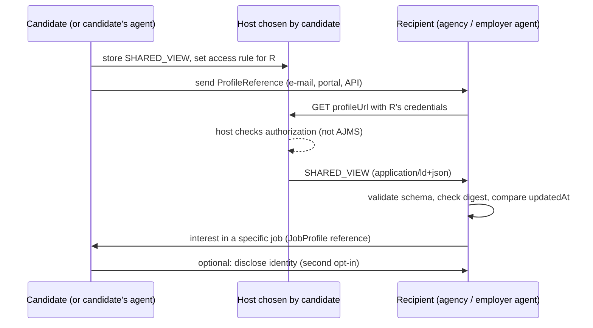

# Privacy and exchange

This document separates two things: **which data a profile representation contains** (views), and **how a recipient finds and retrieves it** (exchange). Neither is a security mechanism. Access control is the job of the system that hosts or transports a profile.

> AJMS makes no claim of compliance with the GDPR, the EU AI Act or any other law. Whether a particular use is lawful depends on the controller, the purpose, the legal basis and the deployment. That is outside the scope of a data format.

## 1. Three representations of a candidate profile

| View | Who has it | Typical content | Not included |
|---|---|---|---|
| **FULL_PRIVATE** | the candidate (or a tool acting only for them) | everything: identity, contact data, employment history with employer names, evidence documents, all preferences | — |
| **SHARED_VIEW** | one named recipient (agency, employer), after the candidate decided to share | capabilities, preferences, history without employer names, evidence descriptions without document links; identity only if the candidate chooses to disclose it | by default: identity, employer names, document links, postal codes, precise coordinates |
| **PUBLIC_MINIMAL** (optional) | anyone | headline, career level, archetypes, competencies, languages, qualifications, coarse preferences, coarse region, earliest start | identity, employment history, evidence, postal codes, coordinates finer than 10 km |

`ajms derive-view --view SHARED_VIEW|PUBLIC_MINIMAL <private.json>` derives the two reduced views deterministically. A derived view gets its own `profileId`, so the views cannot be joined by identifier alone.

### What a reduced view does not achieve

- **Removing names does not make a profile anonymous.** A rare combination of attributes (occupation, region, years of experience, languages, an unusual certificate, exact dates) can identify a person. One of the reviewed real-world exports was labelled "anonymised" but still listed sex, age, exact employment periods and employer-specific descriptions.
- **Shared data can be kept.** Once a recipient has received a view, it can store, copy or forward it. Expiry dates, digests or later deletion requests do not technically remove that copy.
- **A public view is public.** Treat `PUBLIC_MINIMAL` as published. Crawlers and other parties may collect it.

Candidates should share the smallest view that serves the purpose, and only with recipients they have chosen.

## 2. Minimal exchange convention: `ProfileReference`

A ProfileReference announces a profile without containing it:

```json
{
  "@context": "https://raw.githubusercontent.com/CsabaRanks/agentic-job-matching-standard/v0.1.0/context/v0.1/ajms.context.jsonld",
  "@type": "ProfileReference",
  "profileId": "urn:uuid:…",
  "profileType": "CandidateProfile",
  "schemaVersion": "0.1.0",
  "updatedAt": "2026-10-20T09:00:00+02:00",
  "profileView": "SHARED_VIEW",
  "profileUrl": "https://profiles.example.org/p/7c1e0b52.json",
  "accessMethod": "ACCESS_CONTROLLED",
  "mediaType": "application/ld+json",
  "contentDigest": { "algorithm": "SHA-256", "canonicalization": "AJMS-JSON-SORTED-KEYS-V1", "value": "…" },
  "intendedRecipient": "Example Staffing Partner GmbH (synthetic)",
  "expiresAt": "2027-01-31T23:59:59+01:00"
}
```

| Field | Purpose |
|---|---|
| `profileId` | stable identity of the profile (per view) |
| `schemaVersion` | lets the recipient pick the right schema |
| `updatedAt` | lets the recipient detect a newer version without downloading it |
| `profileUrl` | where the document can be retrieved |
| `accessMethod` | `PUBLIC`, `ACCESS_CONTROLLED` (the host authorises each request) or `ON_REQUEST` (ask first via `accessRequestUrl`) |
| `contentDigest` | optional integrity hint: SHA-256 over the profile serialised as UTF-8 JSON with sorted keys and no whitespace. **It is not a signature** and does not prove who created the profile. The canonicalisation is not RFC 8785 (JCS), so it can differ across implementations with different number formatting. |
| `intendedRecipient`, `expiresAt` | information for the recipient; **not enforced** by AJMS |

Rules enforced by the schema: a `FULL_PRIVATE` profile can never be announced with `accessMethod: PUBLIC`, and `ON_REQUEST` requires an `accessRequestUrl`.

`ajms reference <profile.json> --url <https-url> --access ACCESS_CONTROLLED` creates a reference with digest.

## 3. How a protected profile could be retrieved (illustrative)

The following flow shows one possible use. AJMS v0.1 does not standardise any part of it.



Possible host-side mechanisms (none of which AJMS provides): HTTPS with authenticated requests (OAuth 2.0 tokens, signed expiring URLs, mutual TLS), per-recipient storage, access logs, revocation of future access. Whatever the mechanism, revocation cannot recall a copy that was already retrieved.

A **double opt-in** before identity is disclosed is recommended. It is a process, not cryptography: first the recipient states interest based on a view without identity, then the candidate decides whether to disclose identity.

## 4. Matching location

AJMS works for matching on the candidate's device ("the job travels to the candidate"): JobProfiles can be public, and the candidate's agent can compare them locally with the private profile. It also works for matching at a recipient that holds a shared view. The format does not decide where matching happens.

## 5. Optional future extensions (not part of v0.1)

| Technology | Possible role | Status |
|---|---|---|
| W3C Decentralized Identifiers (DIDs) | identifiers for candidates, issuers and agents | not specified |
| W3C Verifiable Credentials | issuer-signed evidence (degrees, certificates, employment) referenced from `evidence` | not specified; **no mandatory credential envelope for the core profile** |
| DIDComm or similar | agent-to-agent transport | not specified |
| Zero-knowledge proofs / selective disclosure | proving a property (e.g. "degree at EQF ≥ 6") without disclosing the document | not specified |

v0.1 contains **no cryptography**, no placeholder proofs and no key material. Any future extension must use an established, reviewed specification rather than invent its own scheme.
